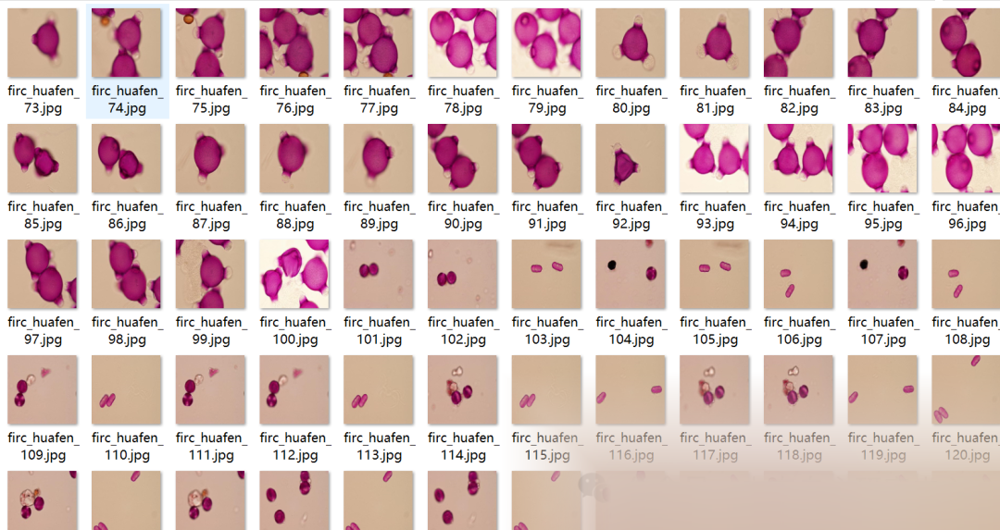
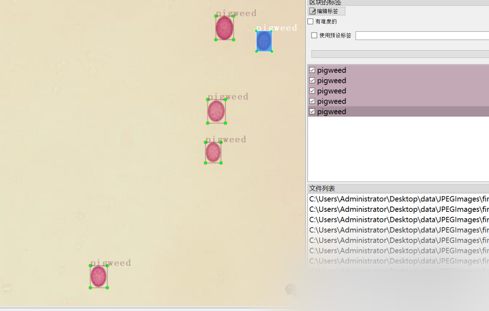

# [Dataset] [Object Detection] Pollen Dataset - Pollen Particle Detection Dataset VOC+YOLO format with 2412 images in 20 categories

Dataset format: Pascal VOC format + YOLO format (txt file without split path, only containing jpg images and corresponding VOC format xml files and yolo format txt files)
Number of images (jpg file count): 2412
Number of annotations (xml file count): 2412
Number of annotations (txt file count): 2412
Number of annotation categories: 20
Annotation category names: ["alder", "angelica", "angelica_garden", "birch", "buckwheat", "clover", "fireweed", "grass", "hazel", "hill_mustard", "linden", "maple", "meadow_pink", "mugwort", "nettle", "pigweed", "pine", "plantain", "sorrel", "willow"]
Box counts for each category:
alder box count = 470
angelica box count = 472
angelica_garden box count = 354
birch box count = 666
buckwheat box count = 213
clover box count = 320
fireweed box count = 366
grass box count = 213
hazel box count = 77
hill_mustard box count = 660
linden box count = 339
maple box count = 1159
meadow_pink box count = 235
mugwort box count = 118
nettle box count = 231
pigweed box count = 317
pine box count = 230
plantain box count = 217
sorrel box count = 271
Number of willow frames = 816
Total number of frames: 7744
Using labeling tool: labelImg
Labeling rules: Draw a rectangle around the category.
Important note: No specifics provided.
Special declaration: This dataset does not guarantee the accuracy or precision of the trained models or weight files, and only provides accurate and reasonable annotations.

Image Preview:

Annotation example:

## Payment

Here is a pay link on Stripe ( https://buy.stripe.com/3cs8yP7sY87d0vu9AB ). Please contact me lonlonago@foxmail.com after funding $89, and I will send you a complete data files , thank you!

